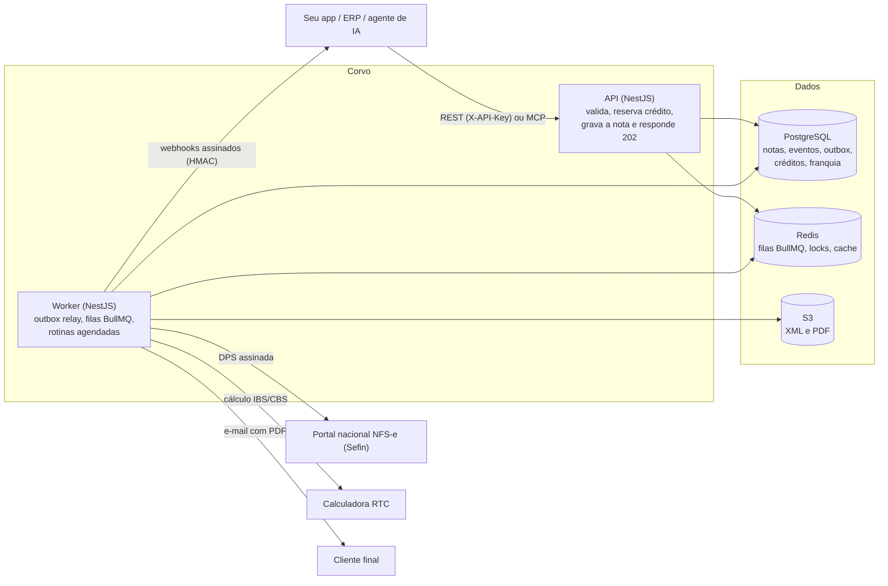
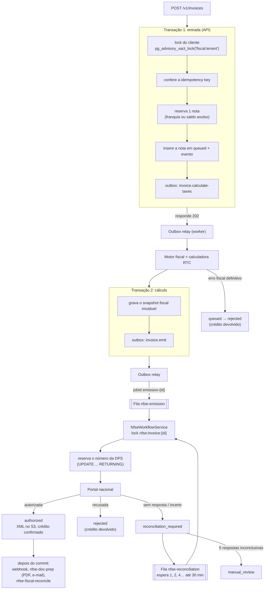
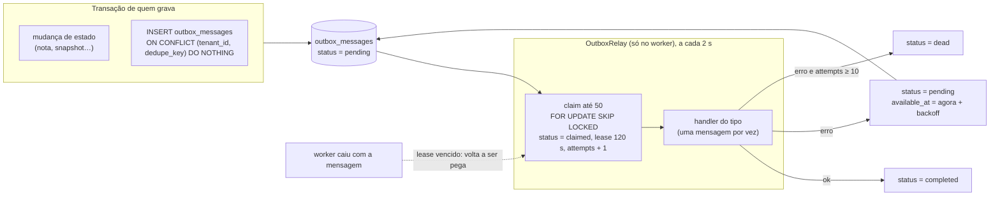
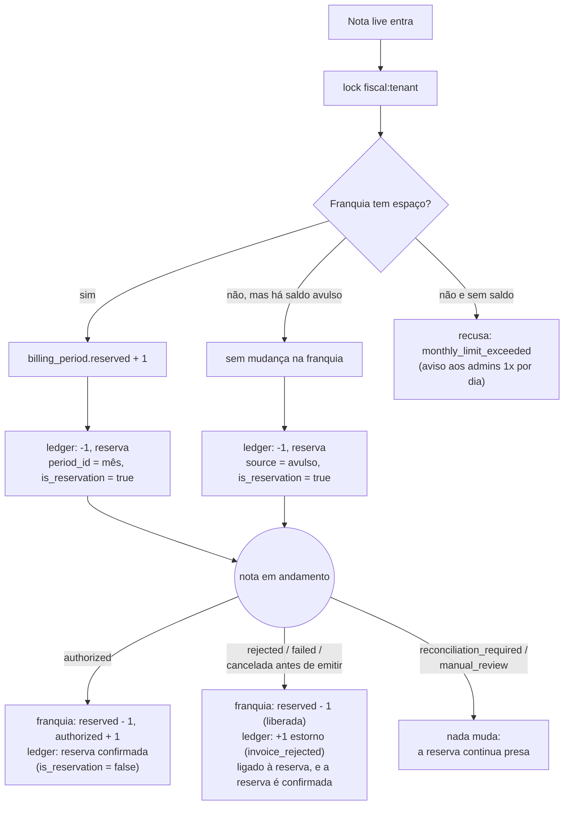
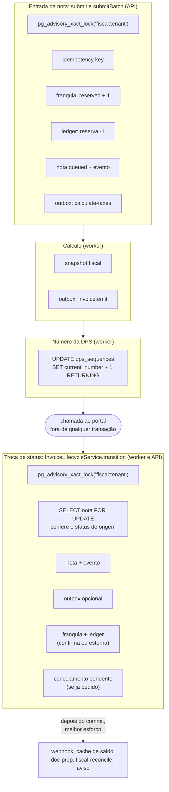
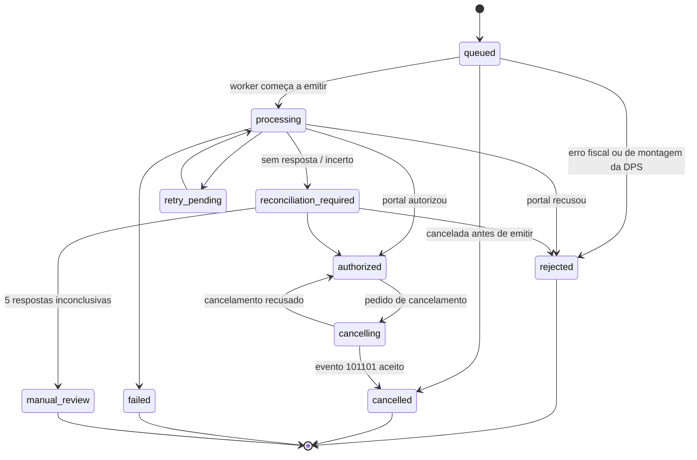

# Arquitetura do Corvo

Como uma NFS-e anda pelo sistema: do pedido na API até a autorização no portal nacional, passando pela outbox, pelos créditos e pelas filas. Para cada passo, diz o que é gravado **junto** na mesma transação e o que acontece se algo falhar no meio.

Este documento descreve a `main`. Os nomes de arquivo apontam para `api/src`.

## Sumário

- [Visão geral](#visão-geral)
- [Caminho de uma nota](#caminho-de-uma-nota)
- [Outbox](#outbox)
- [Créditos: franquia e ledger](#créditos-franquia-e-ledger)
- [Atomicidade: o que é gravado junto](#atomicidade-o-que-é-gravado-junto)
- [Status da nota](#status-da-nota)
- [Filas e rotinas do worker](#filas-e-rotinas-do-worker)
- [Isolamento entre clientes (RLS)](#isolamento-entre-clientes-rls)
- [Garantias e lacunas](#garantias-e-lacunas)
- [Onde está no código](#onde-está-no-código)

## Visão geral

São dois processos com o mesmo código: a **API**, que recebe pedidos e responde rápido, e o **worker**, que faz o trabalho demorado. Eles só conversam pelo banco (outbox) e pelo Redis (filas BullMQ).

A API nunca fala com o portal. Ela grava a nota com uma mensagem na outbox na mesma transação e responde `202`. Todo o resto é do worker.

## Caminho de uma nota

Pontos que valem a revisão:

1. **O cálculo sempre vem antes da emissão.** O `invoice.emit` só é colocado na outbox na mesma transação que grava o snapshot fiscal. Por isso a DPS nunca é montada sem os tributos calculados (`fiscal/calculate-taxes.handler.ts`).
2. **O número da DPS é reservado uma vez.** `payload()` só reserva se a nota ainda não tem número. Ele é guardado na nota antes do envio e reaproveitado em toda nova tentativa (`nfse-workflow.service.ts`, `typeorm-dps-sequence.repository.ts`).
3. **A emissão não sai em dobro.** Antes de enviar, o provedor consulta o portal pela DPS (`fetchDpsStatus`). Se ela já existe, devolve a nota autorizada. A DPS assinada fica em `pending_emission` antes do envio, então uma queda no meio é retomada com o mesmo XML (`infra/external/nfse/open-nfse.provider.ts`).
4. **Uma nota por vez em cada slot.** Emissão e reconciliação usam o mesmo lock no Redis, `nfse:invoice:{id}`, com validade de 5 min.

## Outbox

A outbox garante que "gravar a nota" e "avisar o worker" acontecem juntos: a mensagem é uma linha no mesmo banco, gravada na mesma transação que a mudança.

| Item | Valor | Onde |
| --- | --- | --- |
| Intervalo entre rodadas | 2 s; uma rodada é pulada se a anterior ainda está rodando | `OUTBOX_RELAY_INTERVAL_MS` |
| Mensagens por rodada | até 50, processadas uma por vez | `OUTBOX_BATCH_SIZE` |
| Reserva da mensagem (lease) | 120 s; se o worker cair, outra rodada pega a mensagem depois | `OUTBOX_LEASE_MS` |
| Espera entre tentativas | 2 s, 4 s, 8 s… até 5 min | `outbox-backoff.ts` |
| Tentativas | 10; depois a mensagem fica `dead` | `OUTBOX_MAX_ATTEMPTS` |
| Duplicidade | `dedupe_key` única por cliente (`calc:{id}`, `emission:{id}`) | `typeorm-outbox.repository.ts` |

Tipos de mensagem e o que cada handler faz:

| Tipo | Handler | Faz |
| --- | --- | --- |
| `invoice.calculate-taxes` | `CalculateTaxesHandler` | Roda o motor fiscal. Em sucesso, grava o snapshot e coloca `invoice.emit` na mesma transação. Erro fiscal definitivo rejeita a nota. Erro temporário (por exemplo, a calculadora RTC fora) relança, e a outbox tenta de novo. |
| `invoice.emit` | `InvoiceEmitHandler` | Só coloca o job na fila `nfse-emission` com `jobId = emission-{id}`. Se o job já existe, o BullMQ ignora. |
| `invoice.cancel` | `InvoiceCancelHandler` | Coloca o job na fila `nfse-cancellation`. |

`complete`, `release` e `markDead` só valem se a mensagem ainda está `claimed` com o mesmo número de tentativas. Assim, um worker atrasado não sobrescreve o resultado de outro que pegou a mensagem depois que o lease venceu.

## Créditos: franquia e ledger

Uma nota em `live` gasta crédito. Em `test`, não. O controle tem duas partes que andam juntas:

- **Franquia do plano** (`billing_periods`): contadores do mês, `included`, `reserved` e `authorized`. Limite: `authorized + reserved` não pode passar do teto do plano.
- **Ledger** (`credit_transactions`): um lançamento por movimento, nunca apagado. O saldo avulso é a soma dos lançamentos com `source` igual a `avulso` ou `bonus`.

A franquia paga primeiro. Quando ela acaba (ou o plano venceu), o saldo avulso paga.

| Para onde a nota vai | Franquia | Ledger | Saldo avulso |
| --- | --- | --- | --- |
| `queued` (entrada) | `reserved + 1` se o plano pagou | `-1` reserva | cai 1 se o avulso pagou |
| `authorized` | `reserved - 1`, `authorized + 1` | reserva confirmada | nada muda |
| `rejected`, `failed`, `cancelled` antes de autorizar | `reserved - 1` | `+1` estorno ligado à reserva | volta 1 se o avulso pagou |
| `reconciliation_required`, `manual_review` | nada muda | nada muda | nada muda |
| `cancelled` depois de autorizada | nada muda | nada muda (cancelar uma NFS-e emitida não devolve crédito) | nada muda |

Essas mudanças acontecem dentro da mesma transação da troca de status (`InvoiceLifecycleService.settleCredit`). Por isso não existe nota autorizada com crédito ainda reservado, nem nota rejeitada sem estorno.

## Atomicidade: o que é gravado junto

Cada caixa é uma transação do PostgreSQL. Tudo dentro dela é gravado junto ou nada é gravado.

Como cada regra é garantida:

- **Duas notas do mesmo cliente não furam o limite do plano.** `pg_advisory_xact_lock('fiscal:{tenant}')` faz as reservas e as trocas de status de um cliente acontecerem uma de cada vez. Clientes diferentes não se bloqueiam (`typeorm-billing.repository.ts`, `locked`).
- **Duas trocas de status ao mesmo tempo não se atropelam.** A transição relê a nota com `FOR UPDATE` e só aplica se o status gravado ainda é o de origem esperado. Senão, lança `ConcurrentInvoiceTransitionError` (por exemplo, a nota foi cancelada enquanto o worker emitia).
- **O mesmo pedido não vira duas notas.** A idempotency key é conferida dentro do lock. No lote, uma chave repetida com o mesmo conteúdo devolve a nota existente, e com outro conteúdo devolve `ERROR_IDEMPOTENCY_CONFLICT`.
- **O lote é tudo ou nada para erros inesperados.** `submitBatch` grava todas as notas aceitas numa transação. As recusadas por regra de cobrança ou de chave voltam como erro por item e não gravam nada.
- **A chamada ao portal fica fora das transações.** Ela pode levar segundos, e segurar um lock do banco nesse tempo travaria o cliente. A segurança vem da DPS fixa e da consulta prévia descritas em [Caminho de uma nota](#caminho-de-uma-nota).

## Status da nota

Transições permitidas (`modules/invoice/domain/invoice-status.ts`). Qualquer outra lança `InvalidInvoiceTransitionError`.

`retry_pending` e `failed` existem no modelo, mas o fluxo atual não leva nenhuma nota para eles. `manual_review` hoje não tem saída: a nota fica parada até alguém agir no banco.

## Filas e rotinas do worker

| Fila ou rotina | Quem coloca | O que faz | Tentativas |
| --- | --- | --- | --- |
| `OutboxRelay` (a cada 2 s) | — | Entrega as mensagens da outbox aos handlers | 10, espera até 5 min |
| `nfse-emission` | `invoice.emit` | Monta, assina e envia a DPS (1 por vez por worker; o PR #175 sobe para 3) | 5, espera de 5 s; esgotou: `queued` vira `rejected` e `processing` vai para reconciliação |
| `nfse-reconciliation` | o próprio workflow | Pergunta de novo ao portal pela mesma DPS | 5 por job; espera de 1 min dobrando até 30 min |
| `nfse-doc-prep` | depois da autorização | Gera o PDF e envia o e-mail | 5, espera de 10 s |
| `nfse-fiscal-reconcile` | depois da autorização | Compara o snapshot calculado com a NFS-e autorizada e registra divergências | 5, espera de 10 s |
| `nfse-cancellation` | `invoice.cancel` | Envia o evento de cancelamento 101101 | — |
| `import-read`, `import-emit` | importação de planilha | Lê as linhas e cria as notas em blocos de 50 | — |
| `docs-recovery` (a cada 5 min) | — | Rede de segurança: reenfileira a reconciliação de notas paradas há mais de 5 min em `processing` ou `reconciliation_required`, e o PDF de notas autorizadas sem documento (até 50 de cada por cliente) | 5 por job |
| Webhooks (a cada 30 s) | `InvoiceWebhookPublisher` grava a entrega como `pending` | Entrega os webhooks assinados (`X-Corvo-Signature: sha256=…`) com timeout de 10 s. A primeira tentativa sai no próximo ciclo, até 30 s depois | 5: 0 s, 60 s, 160 s, 15 min, 30 min |
| `EventProcessorScheduler` (a cada 5 s) | integrações de venda | Ver [docs/integrations/architecture.md](integrations/architecture.md) | — |
| Cobrança (de hora em hora) | — | Reconcilia a cobrança (`billing.reconcile`) | — |

## Isolamento entre clientes (RLS)

As tabelas de cliente têm `tenant_id` e política de Row Level Security. Antes de cada operação, `runWithTenant(tenantId, …)` define `app.current_tenant_id` na conexão (`infra/database/rls-connection-scope.ts`), e o PostgreSQL só devolve as linhas daquele cliente.

O worker precisa enxergar vários clientes, e faz isso de duas formas:

- **Outbox relay:** pega as mensagens de todos os clientes em contexto de sistema (`runAsSystem('outbox-relay')`) e executa cada handler dentro de `runWithTenant` do dono da mensagem.
- **Rotinas agendadas** (`docs-recovery`, entrega de webhooks): `TenantWorkDiscovery.visit` descobre em contexto de sistema quais clientes têm trabalho, de 100 em 100, e executa o trabalho de cada um no contexto dele.

## Garantias e lacunas

O que o sistema garante:

- Uma nota aceita (`202`) sempre tem a reserva de crédito e a mensagem de cálculo gravadas. Não existe nota sem crédito reservado, nem crédito reservado sem nota.
- Uma nota nunca é emitida duas vezes no portal pela mesma DPS.
- Toda troca de status grava junto o evento de auditoria e o efeito no crédito.
- Uma mensagem da outbox ou um job que falha é tentado de novo sozinho. Um worker que cai no meio não perde a mensagem.

O que hoje **não** é atômico (vale revisar):

- **Webhooks e e-mail são colocados na fila depois do commit, em melhor esforço.** Se o processo cair entre a troca de status e o `enqueue` do webhook, a nota fica com o status certo, mas o webhook daquela mudança não é enviado. Não há rotina que reenvie. Para documentos (PDF e e-mail) existe a `docs-recovery`.
- **Os jobs pós-autorização (`nfse-doc-prep`, `nfse-fiscal-reconcile`) também são colocados depois do commit.** A falha é só registrada no log. Para o PDF, a `docs-recovery` cobre; para a reconciliação fiscal, não há rotina de recuperação.
- **`manual_review` não tem saída.** A nota segura a reserva de crédito até alguém resolver no banco. O PR #176 adiciona as ações de tentar de novo e descartar.
- **Um erro de rede na emissão agenda a reconciliação e também relança o erro.** Com isso, o job de emissão é repetido e cada repetição agenda outra reconciliação. Os locks evitam emissão em dobro, mas as filas crescem durante uma queda longa. O PR #176 corrige.
- **A `docs-recovery` coloca mais um job de reconciliação a cada 5 min para toda nota parada em `processing` ou `reconciliation_required`, sem chave de deduplicação.** É ela que retoma uma nota cujo agendamento se perdeu, mas, numa queda longa, cada nota acumula um job novo a cada 5 min além dos que já estão esperando. O lock por nota evita processamento simultâneo; os jobs a mais rodam, não emitem nada novo e somam chamadas ao portal. Um `jobId` fixo por nota resolveria. Isso **não** está no PR #176.

## Onde está no código

| Assunto | Arquivo |
| --- | --- |
| Entrada da nota, reserva e troca de status com crédito | `modules/invoice/application/invoice-lifecycle.service.ts` |
| Lock do cliente (`fiscal:{tenant}`) | `modules/billing/infra/typeorm-billing.repository.ts` |
| Regras da franquia | `modules/billing/domain/billing-period.ts`, `modules/billing/application/billing-usage.service.ts` |
| Ledger de créditos | `modules/credits/infra/typeorm-credit-transaction.repository.ts` |
| Outbox (gravar, pegar, concluir) | `modules/invoice/application/outbox.service.ts`, `modules/invoice/infra/typeorm-outbox.repository.ts` |
| Relay da outbox | `modules/invoice/application/outbox-relay.ts` |
| Cálculo e emissão | `modules/invoice/application/fiscal/calculate-taxes.handler.ts`, `modules/invoice/application/invoice-emit.handler.ts` |
| Workflow de emissão e reconciliação | `modules/invoice/application/nfse-workflow.service.ts` |
| Número da DPS | `modules/invoice/infra/typeorm-dps-sequence.repository.ts` |
| Chamada ao portal | `infra/external/nfse/open-nfse.provider.ts` |
| Status e transições | `modules/invoice/domain/invoice-status.ts` |
| Webhooks | `modules/invoice/application/invoice-webhook.publisher.ts`, `modules/webhooks-config/application/webhook-outbox.service.ts` |
| RLS | `infra/database/rls-connection-scope.ts` |
