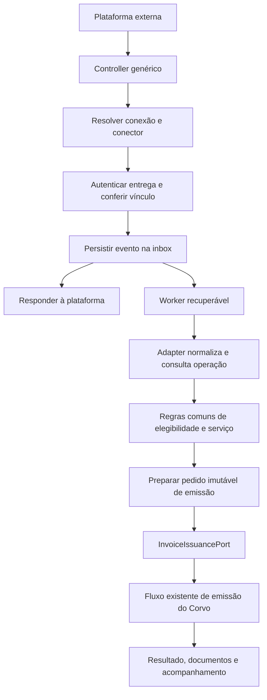

# Integrações de vendas e pagamentos — infraestrutura extensível do Corvo

Data do desenho: 2026-10-17  
Status: implementado. Este documento é o desenho que guiou a infraestrutura; o código está em `api/src/modules/integrations`. Para escrever um conector novo, leia o [guia de conectores](new-connector.md).  
Conectores no repositório hoje: Stripe, AbacatePay, Hotmart, Kiwify, Woovi e PushinPay (`api/src/modules/integrations/connectors`).

## 1. Objetivo e decisão principal

Criar uma infraestrutura que receba eventos de plataformas externas, identifique operações elegíveis e solicite a emissão automática de NFS-e pelo fluxo existente do Corvo.

A infraestrutura de integrações vem primeiro e os conectores reais se apoiam nela. A infraestrutura é verificável com conectores de teste, sem depender de contas ou credenciais dessas plataformas.

Adicionar um conector que implemente as capacidades existentes deve exigir seu Adapter, configuração, registro na composição da aplicação, testes e deploy. O processamento compartilhado, o modelo fiscal e o fluxo de emissão não devem ganhar condições específicas por plataforma.

Isso aplica o princípio aberto para extensão e fechado para alteração. Não significa adicionar uma API desconhecida sem escrever código, nem garantir que requisitos novos de produto nunca exigirão evolução dos contratos.

## 2. Como a automação funciona

O cliente conecta sua conta de vendas ou pagamentos ao Corvo, escolhe a empresa emissora e configura quais operações geram notas. Quando chega um evento elegível, o Corvo consulta os dados necessários, aplica essa configuração e solicita a emissão.

Existem duas conexões distintas:

| Conexão | Responsabilidade |
|---|---|
| Plataforma externa → Corvo | Informar vendas, pagamentos, reembolsos e disputas. |
| Corvo → provedor fiscal | Validar e transmitir a solicitação de NFS-e e acompanhar seu resultado. |

A nota é emitida pela empresa vendedora cadastrada no Corvo. Conectar uma plataforma não substitui a configuração fiscal, o certificado exigido ou a habilitação da empresa.

Webhooks notificam mudanças; APIs permitem consultar detalhes e recuperar informação. Uma confirmação de pagamento, sozinha, pode não identificar o serviço, o tomador ou a responsabilidade pela emissão.

## 3. Escopo por entrega

### 3.1 Infraestrutura

- Contratos e registro de conectores.
- Catálogo de capacidades e descrição dos campos de configuração.
- Cadastro de conexões por tenant, empresa, conta externa e ambiente.
- Proteção das credenciais e validação da conexão.
- Entrada HTTP genérica com autenticação delegada ao conector.
- Inbox persistente de eventos, processamento recuperável e tentativas.
- Modelo comum de operação e referências externas.
- Regras de seleção e vínculo com serviços fiscais.
- Idempotência por evento e por operação de emissão.
- Ponte para o caso de uso existente de emissão.
- API de acompanhamento, pendências, pausa e reprocessamento.
- Observabilidade, isolamento por tenant e testes de contrato.
- Dois conectores sintéticos de teste com formatos e capacidades diferentes.

Os conectores sintéticos existem apenas em testes. Não devem aparecer como integrações disponíveis em produção.

### 3.2 Conectores

Cada conector deve declarar os fluxos efetivamente suportados. A existência de um conector Stripe, por exemplo, não implica suporte imediato a todos os produtos e tipos de cobrança da Stripe.

### 3.3 Recorte inicial do produto

O primeiro fluxo comercial atende operações simples de serviços em BRL, compatíveis com a cobertura fiscal validada do Corvo, com uma empresa emissora por conexão. A confirmação de pagamento é o gatilho operacional; competência e demais regras fiscais continuam explícitas.

Reembolsos e disputas são recebidos e acompanhados. Cancelamento fiscal automático, coprodução, notas de comissão de afiliados, divisão fiscal entre empresas, mercadorias, exportações e importação histórica em massa ficam para escopos próprios.

Não será construído um motor de scripts arbitrários nem carregamento de plugins externos em tempo de execução. Conectores são código versionado e revisado da aplicação.

## 4. Base existente e limites de reaproveitamento

A análise arquitetural passou pelo Graphify e foi conferida nos arquivos abaixo em 2026-10-17.

| Componente existente | Reaproveitamento |
|---|---|
| [InvoiceService](../../api/src/modules/invoice/application/invoice.service.ts) | Validação de entrada, empresa/certificado em produção e idempotência do pedido. |
| [InvoiceLifecycleService](../../api/src/modules/invoice/application/invoice-lifecycle.service.ts) | Persistência transacional de invoice, evento, reserva de uso e mensagem de entrada do cálculo fiscal. |
| [OutboxHandlerRegistry](../../api/src/modules/invoice/application/outbox-handler.registry.ts) | Referência para registro de implementações por tipo. |
| [InvoiceEmitHandler](../../api/src/modules/invoice/application/invoice-emit.handler.ts) | Exemplo de registro na inicialização e publicação na fila existente. |
| [Contexto de tenant](../../api/src/infra/persistence/typeorm/tenant-context.storage.ts) | Escopo de execução e exceções internas enumeradas. |
| [Bootstrap HTTP](../../api/src/bootstrap-http.ts) | Preservação do corpo bruto da requisição. |
| [StripeWebhookController](../../api/src/modules/billing/http/stripe-webhook.controller.ts) | Evidência de que o webhook Stripe atual pertence ao billing do próprio Corvo. |

O Stripe de billing usa a conta e a configuração do Corvo. Os conectores de vendas usam as conexões dos clientes e precisam de rotas e credenciais próprias.

Os webhooks de saída de `webhooks-config` notificam sistemas dos clientes sobre resultados do Corvo. A inbox proposta recebe eventos de plataformas externas; seus registros e suas responsabilidades são diferentes.

A outbox de invoice permanece na entrada fiscal. A nova inbox não exige mover a outbox para um módulo genérico nem substituir por outbox cada etapa posterior do pipeline. Preservar esse limite: a outbox continua sendo da entrada fiscal.

## 5. Arquitetura e fluxo



O Controller recebe, autentica e persiste. Não espera a autorização da NFS-e nem faz consultas comerciais demoradas antes do reconhecimento do evento.

O worker controla execução, tentativas e transições. O conector interpreta a plataforma. As regras comuns decidem se a operação suportada pode gerar uma nota. O módulo fiscal continua responsável pela classificação, validação e emissão.

## 6. Strategy, Adapter, Registry e SOLID

| Elemento | Aplicação |
|---|---|
| Strategy | Selecionar a implementação adequada à conexão. |
| Adapter | Traduzir autenticação, eventos, API e objetos externos para contratos internos. |
| Registry | Localizar conectores pelo identificador e impedir registros duplicados. |
| Responsabilidade única | Separar transporte, interpretação externa, regra comercial e emissão. |
| Aberto para extensão | Adicionar implementações sem editar o processamento comum. |
| Substituição | Executar a mesma suíte de contrato nas implementações das mesmas capacidades. |
| Segregação de interfaces | Catálogo, instalação de webhook e consultas são capacidades independentes. |
| Inversão de dependência | O núcleo depende de portas; SDKs e clientes HTTP ficam nos adapters. |

O módulo compartilhado não deve importar SDKs dos provedores nem conter `switch (provider)` para regras de negócio. A composição da aplicação pode importar e registrar novos módulos: esse é o ponto de extensão previsto.

## 7. Contratos e capacidades

Os nomes abaixo são a proposta para implementação. Assinaturas completas e DTOs serão definidos no plano técnico, preservando estas responsabilidades.

| Contrato | Responsabilidade |
|---|---|
| `WebhookAdapter` | Validar origem, conta/ambiente quando identificáveis, reconhecer testes e extrair notificações. |
| `OperationReader` | Obter estado e dados necessários da operação por acesso autenticado. |
| `OperationNormalizer` | Produzir o modelo comum a partir dos dados verificados disponíveis. |
| `ConnectionValidator` | Verificar credenciais, capacidades e identidade da conta conectada. |
| `WebhookInstaller` | Provisionar e remover webhooks quando houver suporte. |
| `ProductCatalogReader` | Listar produtos ou planos quando a plataforma oferecer catálogo. |
| `OperationRecoveryReader` | Consultar operações perdidas em uma janela, quando suportado. |
| `IntegrationSecretsPort` | Guardar, ler e rotacionar segredos de uma conexão. |
| `InvoiceIssuancePort` | Solicitar a emissão sem expor autenticação HTTP ou SDK externo ao núcleo. |

Cada conector precisa validar a conexão, tratar suas entregas e normalizar as operações suportadas. Consultas complementares são obrigatórias quando a notificação não é suficiente; um conector pode normalizar diretamente um payload completo e verificado.

Capacidades opcionais devem estar ausentes quando não suportadas. Não usar métodos vazios nem lançar `not implemented` em uma capacidade anunciada.

### 7.1 Manifesto do conector

Cada registro declara:

- Identificador estável, nome, versão do adapter e versões externas suportadas.
- Capacidades e fluxos comerciais disponíveis.
- Esquema dos campos de configuração, distinguindo campos secretos.
- Instruções de conexão e teste.
- Limites relevantes de consulta e recuperação.
- Estratégia de autenticação de webhook e tratamento de testes de transporte.

O catálogo público expõe descritores e instruções, nunca credenciais ou payloads privados. Formulários comuns podem ser montados a partir desses descritores. OAuth ou outro fluxo especial pode fornecer uma extensão própria de onboarding.

### 7.2 Registro

Usar registro explícito na inicialização, alinhado ao padrão existente de handlers. Duplicidade de identificador, capacidade inválida ou versão de contrato incompatível deve impedir a inicialização.

No banco, `provider` é um identificador textual validado contra o registro. Evitar um enum de banco que exija migration a cada conector. O cliente de API também deve consumir o catálogo, sem depender de uma união fechada com os cinco nomes.

## 8. Modelo comum de operação

A operação comercial normalizada é diferente do evento que anunciou sua mudança. Um evento pode conter várias referências; vários eventos podem apontar para a mesma operação faturável.

| Grupo | Conteúdo necessário |
|---|---|
| Identidade | Plataforma, conta externa verificada, ambiente e chave estável da operação faturável. |
| Referências | IDs de venda, cobrança, pagamento, fatura e assinatura, quando existentes. |
| Estado | Pagamento confirmado, reembolso, disputa e evidências disponíveis da situação atual. |
| Datas | Ocorrência externa, confirmação do pagamento e período do serviço quando informado. |
| Valores | Moeda, valor comercial, desconto, taxas, juros e líquido separados, quando conhecidos. |
| Tomador | Dados do cliente comercial e sua origem; pagador separado quando aplicável. |
| Itens | Produto/plano, descrição, quantidade e referências de serviço, quando disponíveis. |
| Elegibilidade | Responsável pela emissão, presença de mercadoria e fatos que afetam o recorte suportado. |
| Completude | Campos ausentes e motivo de impossibilidade de emissão. |
| Proveniência | Versão do contrato, adapter e fonte dos dados normalizados. |

Valores monetários devem usar centavos inteiros ou representação decimal exata, nunca cálculos com ponto flutuante. O contrato pode representar outras moedas, mas a política inicial só aceita BRL.

O conector não calcula ISS/IBS/CBS nem escolhe códigos fiscais a partir do nome do produto. Ele informa fatos e referências. O Corvo aplica o vínculo de serviço e encaminha ao motor fiscal.

IDs de assinatura e links reutilizáveis não identificam uma cobrança individual. Cada ciclo pago precisa de identidade própria; parcelas e recorrência não podem ser tratadas como conceitos equivalentes.

## 9. Conexões, credenciais e isolamento

Uma conexão vincula tenant, empresa emissora, plataforma, conta externa e ambiente. A conta deve ser confirmada pelo mecanismo autenticado disponível no provedor. Não confiar apenas no identificador informado pelo navegador.

O endpoint usa um identificador opaco da conexão para localização. Conhecer esse endereço não autentica a entrega. O conector ainda valida segredo/assinatura e verifica se os recursos pertencem à conta e ao ambiente esperados.

Alguns provedores assinam todos os eventos com a mesma chave pública. Nesses casos, assinatura válida identifica o remetente, mas não comprova que o evento pertence à conexão escolhida. Exigir o vínculo de conta por dados autenticados, segredo específico e/ou consulta autenticada ao recurso.

Resolver inicialmente apenas os dados mínimos da conexão por uma porta interna de lookup. Qualquer exceção de RLS necessária deve ser enumerada e restrita. Depois da validação, persistência e processamento acontecem no escopo de `runWithTenant`.

Credenciais ficam cifradas ou em armazenamento de segredos, referenciadas pela conexão. Não usar uma variável global por plataforma para representar todas as contas. Não expor segredos em respostas, logs, Sentry, métricas ou URLs exibidas na interface.

Separar `test` e `live` em conexão, eventos, operações, idempotência e emissão. Rejeitar inconsistência de ambiente. Rotação e revogação devem ser auditáveis.

Estados da conexão: `draft`, `active`, `paused`, `reauth_required` e `disconnected`. Ativação exige credencial validada, empresa pronta e regra aplicável. Pausa interrompe novas emissões, mas preserva eventos autenticados e o registro de reembolsos/disputas. A retomada deve mostrar o intervalo pendente e exigir decisão explícita sobre o que reprocessar.

## 10. Inbox e reconhecimento do webhook

### 10.1 Entrada

1. Resolver conexão e conector, com limites de tamanho e de frequência.
2. Preservar corpo bruto, headers e parâmetros necessários à autenticação.
3. Autenticar a entrega e conferir os vínculos verificáveis.
4. Distinguir evento comercial, evento ignorado e teste de transporte.
5. Persistir duravelmente a entrega autenticada e sua identidade.
6. Confirmar recebimento com a resposta prevista pelo protocolo do conector.

Falha de persistência não pode resultar em confirmação de sucesso. Duplicatas autenticadas já persistidas podem ser reconhecidas sem repetir o efeito comercial.

O contrato deve representar a resposta a testes/handshakes sem incluir condições por provedor no Controller. Um teste de transporte não cria uma operação nem uma nota.

Autenticação inválida é rejeitada antes da inbox comercial; registrar apenas informação sanitizada do erro. Evento autenticado com payload incompatível deve ficar diagnosticável e sem emissão. A política de resposta de transporte deve considerar o protocolo e a possibilidade de recuperação do provedor.

### 10.2 Recuperação e processamento

A fonte durável de trabalho é o banco. Um worker reivindica eventos elegíveis com lease e proteção contra concorrência. Uma fila BullMQ pode acelerar o processamento, mas perder a publicação para Redis não pode deixar o evento esquecido.

Prever varredura de eventos pendentes e leases expirados. Cada claim possui identificador ou versão de tentativa; conclusão por worker com lease vencido não pode sobrescrever uma execução mais nova.

Não manter transações de banco abertas durante chamadas às plataformas. Aplicar timeout, limites por conexão/provedor e backoff com jitter. `429`, indisponibilidade e falhas temporárias permitem nova tentativa; credencial revogada requer reconexão; dado ausente ou regra ambígua requer pendência.

Estados do evento: `received`, `processing`, `retry_pending`, `processed`, `ignored`, `needs_attention` e `dead`. `processed` significa que seu efeito foi tratado, não que a nota foi autorizada.

## 11. Persistência proposta

Usar quatro estruturas no schema `corvo`, seguindo migrations, RLS e convenções existentes. Esta seção define entidades e invariantes; DDL e índices completos pertencem ao plano de implementação.

| Estrutura | Dados principais |
|---|---|
| `integration_connections` | Tenant, empresa, ambiente, provider, conta externa, estado, início de vigência, configuração validada e referência aos segredos. |
| `integration_events` | Conexão, tenant, ambiente, identidade da entrega, tipo externo, referência ao payload protegido, versão, estado, tentativas, lease, próxima execução e erro sanitizado. |
| `integration_operations` | Identidade econômica, referências externas, snapshot normalizado, estado comercial, regra aplicada, pedido de emissão congelado, chave de idempotência e vínculo com invoice. |
| `integration_rules` | Conexão, seleção de produtos/cobranças, vínculo de serviço, política de competência, envio de e-mail, versão e vigência. |

Operações têm eixos distintos: estado comercial, prontidão dos dados e estado do encaminhamento fiscal. Uma nota pode já estar autorizada quando a venda passa a reembolsada; não sobrescrever um estado com o outro.

Invariantes de persistência:

- Identidade da entrega única por tenant, ambiente, plataforma e conta externa, usando chave documentada pelo conector.
- Identidade faturável única por tenant, ambiente, plataforma, conta externa e operação canônica, para a finalidade de emissão inicial.
- Identidade de conta em conexão ativa protegida contra duplicação que permita emissão concorrente da mesma origem.
- Referências e vínculo com invoice preservados ao reconectar a mesma conta.
- Evento e operação mantêm trilha das versões que produziram o resultado.
- Claims possuem índices de estado, disponibilidade e vencimento de lease.
- Todas as tabelas com dados de tenant entram nas políticas de RLS e nas verificações existentes de inventário de tabelas.

Se a modelagem precisar separar aliases de operação ou tentativas em tabelas auxiliares, a implementação deve preservar essas mesmas garantias. Não criar tabelas de vendas específicas para cada plataforma.

## 12. Idempotência e pedido de emissão congelado

Existem duas identidades independentes: entrega e operação faturável. Deduplicar apenas o ID do webhook não basta para eventos distintos que apontam à mesma venda ou para reenvios que gerem outro ID.

O conector define uma chave canônica por fluxo. Exemplos conceituais: fatura individual em recorrência; cobrança individual em link reutilizável; transação de venda em marketplace. Recursos equivalentes, como fatura, Checkout e PaymentIntent, precisam convergir quando representarem o mesmo fato faturável.

A chave de emissão deve derivar de uma representação canônica de tenant, ambiente, plataforma, conta externa estável, operação e finalidade. Não usar `connectionId`, versão da regra ou ID do evento como identidade econômica. Reconectar, alterar a regra ou reenviar um aviso não autoriza uma segunda emissão.

Antes da primeira tentativa fiscal, persistir uma única preparação da operação sob controle de concorrência:

- Regra e versão selecionadas.
- Empresa emissora, competência e dados do tomador/serviço.
- Valores exatos e pedido de emissão completo.
- Chave de idempotência e hash do pedido.

Uma nova tentativa reutiliza esse pedido. Não recalcular competência com a data atual nem incorporar silenciosamente mudanças de cadastro. Isso evita conflito com o hash de idempotência já validado pelo emissor.

Se a emissão for aceita e o processo cair antes de salvar `invoiceId` na operação, o replay com a mesma chave e o mesmo pedido deve recuperar a invoice existente e concluir o vínculo.

Correção após rejeição exige um fluxo explícito com histórico da tentativa e prova de que não existe autorização ou transmissão incerta. Enquanto houver resultado incerto, encaminhar para conciliação; não trocar a chave e emitir novamente.

## 13. Regras de elegibilidade e emissão

Ordem de avaliação:

1. Conexão ativa e operação dentro da vigência escolhida.
2. Conta e ambiente coerentes.
3. Confirmação comercial válida para o fluxo suportado.
4. Responsabilidade do vendedor pela emissão, quando o provedor informar esse fato.
5. Operação e moeda dentro do recorte contratado.
6. Regra de serviço única e dados suficientes.
7. Ausência de emissão anterior, reembolso ou impedimento conhecido.
8. Empresa, certificado e uso do plano válidos pelo caso de uso fiscal existente.

Seleções iniciais:

- Produto ou plano externo → serviço fiscal da empresa.
- Regra padrão explícita da conexão para cobranças sem catálogo, somente dentro da seleção configurada.

Não escolher arbitrariamente entre regras sobrepostas. Não transformar recebimentos, saques, transferências ou qualquer entrada de saldo em venda. Não usar pagador como tomador sem evidência e não preencher documento mascarado com valor inventado.

Valor líquido recebido não é automaticamente valor do serviço. Descontos, taxas, juros, parcelamento e comissões devem continuar separados até a política decidir os campos suportados. Ambiguidade gera pendência.

Pagamento confirmado é gatilho operacional. A competência é determinada por política explícita compatível com a operação e a regra fiscal, sem assumir que a data de recebimento ou o fim da garantia sempre define a competência.

Não oferecer agendamento após garantia como comportamento genérico nesta etapa. Ele depende de especificação própria e dos limites atuais de agendamento do Corvo.

Se duas plataformas representarem a mesma venda, configurar uma origem emissora. Igualdade de nome, valor e horário não é prova de identidade. Conciliação entre plataformas exige referência comercial explícita.

## 14. Integração com o emissor existente

O módulo de integrações chama `InvoiceIssuancePort`, implementada por uma ponte no lado de invoice. Conectores não chamam diretamente o provedor fiscal nem publicam jobs em `nfse-emission`.

Hoje, `InvoiceService.emit()` recebe um DTO HTTP, tenant e `AuthContext`. A infraestrutura deve adaptar essa fronteira uma vez para expor um comando interno de emissão e contexto confiável com tenant, empresa, ambiente, identidade da conexão e auditoria.

Essa adaptação deve preservar o contrato HTTP atual e manter uma única implementação das verificações de empresa, certificado, limites, reserva de uso, normalização, idempotência e submissão transacional. Não fabricar usuário administrador, sessão ou chave de API para executar o worker.

O contexto da integração deve ser validado pela ponte: conexão ativa, autorização da automação e empresa/ambiente vinculados. Não aceitar privilégios arbitrários do payload externo.

A ponte retorna o identificador da solicitação aceita e permite recuperar o resultado existente por idempotência. Aceitação não equivale a autorização fiscal. O acompanhamento reutiliza o estado real da invoice e seus documentos.

Se houver alterações para criar essa porta, elas pertencem à fase de infraestrutura. Adicionar os conectores posteriormente não deve exigir nova alteração no emissor.

## 15. Reembolsos, disputas e eventos fora de ordem

Eventos não devem ser aplicados cegamente pela ordem de chegada. Quando necessário, consultar o estado autenticado atual e preservar o histórico para evitar que um aviso antigo de pagamento reverta um reembolso conhecido.

| Situação | Comportamento inicial |
|---|---|
| Reembolso conhecido antes da submissão fiscal | Bloquear nova emissão e registrar o motivo. |
| Disputa aberta antes da submissão | Suspender a decisão e criar pendência. |
| Reembolso após submissão ou autorização | Vincular à invoice e criar pendência de tratamento fiscal. |
| Estorno parcial | Registrar valores e exigir tratamento específico; não presumir cancelamento integral. |
| Cancelamento da assinatura | Interromper expectativas futuras; não cancelar notas de ciclos passados automaticamente. |
| Aviso antigo de pagamento após reembolso | Preservar o impedimento e conferir a situação atual. |

Não existe transação distribuída com a plataforma. Um reembolso pode ocorrer imediatamente depois da última consulta e da submissão da nota. O recebimento posterior deve abrir a pendência correspondente, sem promessa de cancelamento automático.

O cancelamento fiscal exige um fluxo separado e condições aplicáveis. A API oferece `POST /v1/invoices/:id/cancel`: uma nota `queued` é cancelada localmente e uma NFS-e autorizada (ou em emissão) recebe o evento 101101 na Sefin, com o resultado informado por `nfse.invoice.cancelled` ou `nfse.invoice.cancellation_rejected`. O cancelamento é sempre pedido explicitamente: um reembolso ou estorno recebido de uma plataforma não dispara o cancelamento da nota.

## 16. API e experiência de configuração

Rotas conceituais, sob o prefixo e as convenções existentes da API:

| Operação | Rota proposta |
|---|---|
| Catálogo de conectores instalados | `GET /integrations/providers` |
| Criar/listar conexão | `POST /integrations/connections`, `GET /integrations/connections` |
| Consultar/atualizar configuração | `GET /integrations/connections/:id`, `PATCH /integrations/connections/:id` |
| Validar credenciais e vínculo | `POST /integrations/connections/:id/validate` |
| Ativar, pausar ou desconectar | Ações explícitas em `/integrations/connections/:id/...` |
| Gerenciar regras | `/integrations/connections/:id/rules` |
| Consultar eventos e operações | `/integrations/connections/:id/events`, `/integrations/connections/:id/operations` |
| Reprocessar com auditoria | `POST /integrations/events/:id/reprocess` |
| Receber evento externo | `POST /integrations/inbound/:connectionPublicId` |

Rotas administrativas usam autenticação e permissões do tenant, com paginação e filtros pelos padrões do repositório. A rota de entrada usa a autenticação do conector e deve evitar conflito com `/webhooks/stripe` do billing.

Fluxo do usuário:

1. Escolher plataforma, empresa e ambiente.
2. Informar credenciais ou completar autorização específica.
3. Validar conta e configurar o recebimento das notificações.
4. Selecionar produtos/cobranças e vincular serviço e competência.
5. Conferir a prévia de uma operação ou teste sem emissão real implícita.
6. Escolher data de início e ativar explicitamente a automação.
7. Acompanhar operações, notas e pendências com links entre seus registros.

A interface diferencia conexão válida, webhook recebido e nota autorizada. Testar credenciais ou transporte não pode emitir uma nota real como efeito oculto. Um piloto com emissão real exige ação explícita do usuário.

## 17. Observabilidade e operação

Registrar correlação entre conexão, evento, operação, tentativa e invoice. Logs devem conter identificadores e erros sanitizados, sem segredos ou dados pessoais completos.

Métricas mínimas: eventos aceitos/duplicados/rejeitados, idade do pendente mais antigo, falhas por etapa, tentativas esgotadas, operações com pendência e tempo até aceite/autorização fiscal. Usar provider, ambiente e categoria de resultado como dimensões; evitar IDs de cliente/tenant em labels de alta cardinalidade.

Alertar para crescimento de backlog, falhas de credenciais e interrupção de processamento. Reprocessamento manual registra responsável, motivo e resultado, preservando a idempotência.

Payloads necessários a replay devem ficar protegidos, com acesso restrito e política explícita de retenção. Não guardar indiscriminadamente headers de autorização ou parâmetros secretos. A limpeza de payloads não deve apagar as identidades usadas para impedir nova emissão.

Recuperar eventos já aceitos é obrigação da infraestrutura. Descobrir eventos nunca entregues depende da capacidade de consulta do conector. Prever o contrato e o checkpoint desde a base; documentar limites e janelas por plataforma antes de ativar cada conector.

## 18. Organização proposta do código

```text
api/src/modules/integrations/
  domain/          # Operações, conexões, regras, contratos e repositórios
  application/     # Registry, recebimento, regras, preparação e reprocessamento
  http/            # Gestão das conexões e entrada HTTP genérica
  jobs/            # Claims, processamento e recuperação da inbox
  infra/           # Persistência, segredos e clientes de infraestrutura comuns
  connectors/      # Módulos adicionados após a infraestrutura
    stripe/
    abacatepay/
    hotmart/
    kiwify/
    woovi/
  testing/         # Fixtures e conectores sintéticos restritos a testes
```

A árvore descreve o destino arquitetural. A fase de infraestrutura não precisa criar pastas vazias dos cinco provedores. Repositórios e portas seguem as convenções reais de NestJS, TypeORM e DDD do projeto.

## 19. Critérios para concluir a infraestrutura

A infraestrutura só está pronta para receber os conectores reais quando estes comportamentos estiverem demonstrados:

| Cenário | Resultado esperado |
|---|---|
| Segundo conector sintético com formato diferente | Funciona por registro e contratos, sem editar núcleo fiscal ou orquestrador. |
| Capacidade opcional ausente | Catálogo e API tratam a ausência sem método vazio ou erro inesperado. |
| Autenticação inválida ou conta/ambiente incompatível | Nenhuma operação fiscal é criada. |
| Mesmo evento recebido simultaneamente | Um registro lógico de entrega e um efeito comercial. |
| Eventos diferentes da mesma operação | Uma solicitação inicial de emissão. |
| Queda após salvar evento e antes de publicar na fila | Worker recupera o trabalho a partir do banco. |
| Worker perde lease | Execução antiga não sobrescreve conclusão de nova tentativa. |
| Queda após aceite da invoice e antes do vínculo local | Replay recupera a mesma invoice sem nova reserva de uso. |
| Regra/cadastro muda entre tentativas | Pedido congelado e chave de idempotência permanecem iguais. |
| Conta é reconectada | Operação antiga não gera outra nota. |
| Reembolso chega antes de aviso antigo de pagamento | Emissão não é liberada por regressão de estado. |
| Dados do tomador/serviço faltam | Pendência visível; nenhum dado é inventado. |
| Conexão pausada | Novas emissões bloqueadas; eventos autenticados continuam rastreáveis. |
| Limite de uso ou certificado inválido | Respeitados pelo mesmo caso de uso da emissão existente. |
| Outro tenant consulta evento/conexão/operação | Acesso negado por autorização e RLS. |
| Fluxo HTTP já existente | Contrato de emissão e processamento fiscal preservados. |

Usar testes unitários para regras e contratos, integração PostgreSQL para unicidade/claims/RLS e testes do fluxo de recuperação. Nenhum teste da fase de infraestrutura depende de credenciais reais. A homologação fiscal existente continua sendo uma verificação separada.

## 20. Notas de pesquisa por conector

Esta seção registra pontos da investigação de cada plataforma. Não é garantia de cobertura integral: o que cada conector suporta de fato está no código e no manifesto dele. Revalide a documentação da plataforma, as permissões e os payloads reais ao mexer em um conector.

### 20.1 Stripe

Começar com conexão assistida por chave restrita e webhook da conta do cliente, com segredo de assinatura próprio. Não reutilizar as credenciais globais de billing do Corvo. Stripe Apps com OAuth pode melhorar o onboarding em etapa posterior.

Separar assinaturas de Checkout avulso. Para assinaturas, avaliar `invoice.paid`; para Checkout, verificar o estado de pagamento e contemplar confirmação assíncrona. Evitar que eventos de Checkout, fatura e PaymentIntent gerem três emissões da mesma operação.

Fontes: [API keys](https://docs.stripe.com/keys), [webhooks](https://docs.stripe.com/webhooks), [assinaturas](https://docs.stripe.com/billing/subscriptions/webhooks), [Checkout](https://docs.stripe.com/checkout/fulfillment?payment-ui=stripe-hosted), [Stripe Apps](https://docs.stripe.com/stripe-apps/api-authentication).

### 20.2 AbacatePay

Fixar a versão suportada; a documentação atual da v2 descreve Checkout pago, pagamento transparente e renovação. Em links reutilizáveis, identificar cada pagamento.

Aceitar o formato novo (Standard Webhooks: `webhook-id`, `webhook-timestamp`, `webhook-signature`, HMAC-SHA256 de `id.timestamp.corpo` com o Secret da conexão, tolerância de 5 minutos) e o antigo (secret na URL e `X-Webhook-Signature`). O HMAC antigo usa uma chave pública e não substitui o segredo privado da conexão como prova de origem. Suprimir o parâmetro secreto dos logs. Webhooks trazem o documento mascarado: consultar o cliente pela API com a chave do cliente (`CUSTOMER:READ`). O nome do produto, para a descrição da nota, vem de `GET /v2/products/get` (`PRODUCT:READ`). Upsell é a mesma venda, não uma operação nova. Reenvio manual pode gerar novo ID, reforçando a deduplicação por operação.

Fontes: [autenticação](https://docs.abacatepay.com/pages/authentication), [webhooks](https://docs.abacatepay.com/pages/webhooks), [segurança](https://docs.abacatepay.com/pages/webhooks/security), [cliente](https://docs.abacatepay.com/pages/client/get).

### 20.3 Hotmart

Validar o Hottok do webhook e usar as credenciais oficiais para consultas necessárias. Começar com compras aprovadas no modelo simples de vendedor responsável pela emissão. Verificar `invoice_by` e o modelo comercial antes da elegibilidade. Coprodução e comissão de afiliado exigem outro escopo.

Os dados do comprador dependem do cadastro/checkout. Não considerar todo evento aprovado suficiente para emitir automaticamente.

Fontes: [autenticação](https://developers.hotmart.com/docs/pt-BR/start/app-auth/), [webhook de compra v2](https://developers.hotmart.com/docs/en/2.0.0/webhook/purchase-webhook/).

### 20.4 Kiwify

Usar Client ID e Client Secret para obter acesso à API, com Account ID nas consultas que o exigem. O cadastro de webhook permite selecionar produtos e gatilhos, como `compra_aprovada`, reembolso e renovação.

Confirmar na implementação o formato efetivamente entregue do token/autenticação do webhook de vendas da conta utilizada. Não assumir que o mecanismo de outra família de APIs da Kiwify se aplica ao mesmo fluxo. Conferir a venda por API quando necessário e relacionar avisos de renovação e compra à mesma operação.

Fontes: [token OAuth](https://docs.kiwify.com.br/api-reference/auth/oauth), [criação de webhook](https://docs.kiwify.com.br/api-reference/webhooks/create), [consulta de venda](https://docs.kiwify.com.br/api-reference/sales/single).

### 20.5 Woovi

Sem credencial do cliente: a Corvo gera um token e o cliente o cola no cabeçalho `Authorization` do webhook (Cabeçalhos HTTP). Começar por cobrança paga, `OPENPIX:CHARGE_COMPLETED`, sem tratar qualquer Pix recebido como venda. Conferir a distinção entre pagador e cliente da cobrança.

Exigir o token do cabeçalho `Authorization` (prova o vínculo com a conexão). Se `x-webhook-signature` vier, validá-la pela chave pública. O material específico de segurança documenta RSA-SHA256; não copiar a interpretação de HMAC com o mesmo header presente em materiais auxiliares. A descrição do serviço na nota é o `comment` da cobrança. Tratar teste de cadastro sem emitir nota. Não abrir subcontas ou implementar BaaS para atender este recorte.

Fontes: [autenticação](https://developers.woovi.com/docs/apis/api-getting-started), [eventos](https://developers.woovi.com/docs/webhook/webhook-events-type), [assinatura recomendada](https://developers.woovi.com/docs/webhook/seguranca/webhook-signature-validation), [chaves públicas](https://developers.woovi.com/docs/webhook/seguranca/webhook-public-keys).

## 21. Procedimento para adicionar outro conector

1. Definir o fluxo comercial atendido, a versão externa e os limites de cobertura.
2. Verificar se o contrato comum representa os fatos necessários. Se houver capacidade nova de produto, especificar sua evolução antes de escondê-la em campos livres.
3. Implementar somente as capacidades suportadas, mantendo SDKs e regras de transporte dentro do módulo do conector.
4. Definir identidade de conta, entrega e operação faturável, incluindo eventos equivalentes e reconexão.
5. Declarar manifesto, configuração, permissões mínimas e instruções.
6. Registrar o módulo na composição, sem condições por plataforma no núcleo.
7. Executar a suíte comum e testar fixtures reais sanitizadas, assinatura/token, teste de transporte e recuperação.
8. Homologar com conta de teste e piloto controlado, documentando o recorte antes de habilitar produção.

Alterações esperadas: módulo do conector, registro de composição, fixtures, testes e documentação. Mudanças no núcleo fiscal ou migrations específicas de provedor indicam requisito novo ou abstração a revisar.
