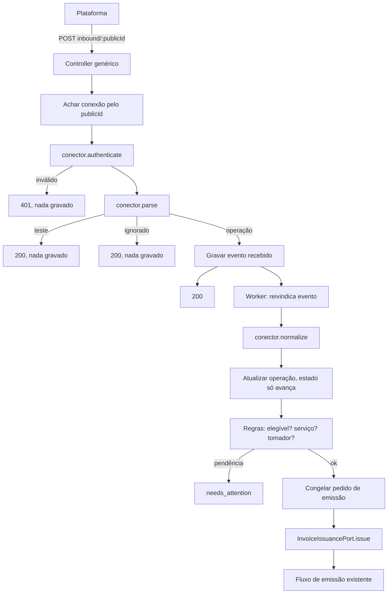

# Integrações de pagamento com emissão automática de NFS-e — spec

Data: 2026-10-29
Status: proposta para revisão; nenhuma implementação iniciada.
Base: refina [docs/integrations/architecture.md](../../integrations/architecture.md) (2026-10-17), que continua sendo a referência de princípios. Onde esta spec e aquele documento divergem, vale esta spec.

## 1. Objetivo

O cliente conecta a conta dele na **Woovi**, na **AbacatePay** ou na **Stripe** ao Corvo. Quando um pagamento é confirmado, o Corvo emite a NFS-e sozinho, pelo mesmo caminho de emissão que a API já usa. Nenhuma plataforma ganha código especial no núcleo: cada uma é um conector.

Fora de escopo desta spec: Hotmart e Kiwify (a arquitetura permite adicioná-las depois), cancelamento automático de nota por reembolso, coprodução, comissões, mercadorias, moedas que não sejam BRL e agendamento da emissão para depois do prazo de garantia.

## 2. Decisões desta spec

| # | Decisão | Motivo |
|---|---|---|
| D1 | **Um endpoint de entrada para todas as plataformas:** `POST /v1/integrations/inbound/:publicId`. | É o "webhook agnóstico". O `publicId` só localiza a conexão; quem autentica é o conector. |
| D2 | **Quatro tabelas:** `integration_connections`, `integration_events`, `integration_operations`, `integration_rules`. Todas com RLS. | Igual à arquitetura de 17/10, sem tabelas por plataforma. |
| D3 | **O banco é a fonte do trabalho.** O worker lê eventos pendentes com `FOR UPDATE SKIP LOCKED` e um prazo (lease). Não há fila nova. | Se o Redis cair, nada se perde. Menos peças que BullMQ + banco. |
| D4 | **Conector = um objeto com 4 métodos** (`authenticate`, `parse`, `normalize`, `validateConnection`) e um manifesto. Sem instalador automático de webhook e sem leitor de recuperação nesta fase. | O cliente cola a URL no painel da plataforma. Recuperação de eventos perdidos fica para depois, por conector que a suporte. |
| D5 | **Quando emitir:** na confirmação do pagamento, imediatamente. A competência é a data da confirmação no fuso `America/Sao_Paulo`. | Recorte inicial do produto. Outras políticas exigem spec própria. |
| D6 | **Tomador sem CPF/CNPJ utilizável** (ausente ou mascarado) vira **pendência**; o Corvo não inventa o dado. A regra pode permitir nota sem tomador (`allowAnonymousCustomer`, padrão `false`), como a API já permite. O cliente completa os dados da pendência e reprocessa. | Pix muitas vezes chega sem documento completo. |
| D7 | **Crédito:** a nota emitida por integração consome crédito e respeita limites exatamente como a API. Em ambiente `test` não consome, como hoje. | Um único caminho de emissão. |
| D8 | **Reembolso ou disputa nunca cancela nota.** Antes de a nota ser enviada, bloqueia a emissão. Depois, cria pendência para o cliente decidir. | Cancelamento fiscal é decisão explícita (`POST /v1/invoices/:id/cancel`). |
| D9 | **Ordem de entrega:** infraestrutura → Woovi → AbacatePay → Stripe. | Pix tem venda única e fluxo simples. A Stripe junta fatura, Checkout e PaymentIntent no mesmo fato. |
| D10 | **O ambiente (`test`/`live`) é escolhido na conexão.** Quando a plataforma informa o ambiente no evento (`devMode` na AbacatePay, `livemode` na Stripe), um evento de ambiente diferente é descartado. A Woovi não informa; vale a conexão. | Impede nota de produção disparada por pagamento de teste. |

## 3. Fluxo



O controller só autentica e grava. Nenhuma consulta à plataforma nem à prefeitura acontece antes do `200`.

## 4. Contratos

Arquivos em `api/src/modules/integrations/domain/`.

```ts
export type IntegrationEnvironment = 'test' | 'live';

export interface InboundRequest {
  rawBody: Buffer;
  headers: Record<string, string | undefined>; // chaves em minúsculas
  query: Record<string, string | undefined>;
}

/** O que o conector vê da conexão. Credenciais já decifradas, só em memória. */
export interface ConnectionView {
  publicId: string;
  environment: IntegrationEnvironment;
  externalAccountId: string;
  credentials: Record<string, string>;
}

export type ParsedDelivery =
  | { kind: 'test' }
  | { kind: 'ignored'; externalType: string }
  | {
      kind: 'operation';
      deliveryId: string; // estável entre reenvios do mesmo evento
      externalType: string;
      environment?: IntegrationEnvironment; // quando a plataforma informa
      externalAccountId?: string; // quando o evento identifica a conta
    };

export type DeliveryAuth = { ok: true } | { ok: false; reason: string };

export interface NormalizedOperation {
  operationKey: string; // identidade da cobrança individual, ex. "charge:abc"
  commercialState: 'pending' | 'paid' | 'refunded' | 'disputed' | 'canceled';
  externalRefs: Record<string, string>;
  occurredAt: Date;
  paidAt: Date | null;
  currency: string;
  amountCents: number; // inteiro
  discountCents: number;
  customer: {
    name: string | null;
    email: string | null;
    taxId: string | null; // só dígitos; null se ausente
    taxIdMasked: boolean; // true quando a plataforma mascarou o documento
  } | null;
  items: Array<{ externalProductId: string | null; description: string | null; quantity: number }>;
  sellerIssuesInvoice: boolean; // false quando a plataforma informa que outro emite
}

export interface Connector {
  readonly manifest: ConnectorManifest;
  authenticate(req: InboundRequest, connection: ConnectionView): Promise<DeliveryAuth>;
  parse(req: InboundRequest): ParsedDelivery;
  normalize(input: { connection: ConnectionView; payload: unknown; delivery: Extract<ParsedDelivery, { kind: 'operation' }> }): Promise<NormalizedOperation>;
  validateConnection(credentials: Record<string, string>): Promise<{ externalAccountId: string }>;
}
```

`ConnectorManifest`: `id` (texto estável, ex. `woovi`), `name`, `version`, `credentialFields` (lista com `key`, `label`, `secret: boolean`), `webhookInstructions` (texto, pt e en), `supportedFlows` (lista de textos). O catálogo `GET /integrations/providers` expõe o manifesto sem nenhum segredo.

Erros que o conector pode lançar em `normalize` e `validateConnection`:

| Erro | Efeito |
|---|---|
| `ConnectorTransientError` | Evento volta para `retry_pending` com backoff. |
| `ConnectorAuthError` | Conexão vai para `reauth_required`; evento vira `needs_attention`. |
| `ConnectorDataError` | Evento vira `needs_attention` com o motivo. |

`provider` é texto validado contra o registro, nunca um enum de banco.

## 5. Dados

Schema `corvo`, migrations TypeORM no padrão do repositório, RLS com a mesma política de `company_simples_rates` (`tenant_isolation_policy`, `FORCE ROW LEVEL SECURITY`).

**`integration_connections`**: `id uuid pk`, `tenant_id`, `company_id → nfse_companies`, `public_id text unique` (24 caracteres aleatórios, base64url), `provider text`, `environment text`, `external_account_id text null`, `state text` (`draft`, `active`, `paused`, `reauth_required`, `disconnected`), `credentials_enc text` (JSON cifrado com `SecretsCipherService`), `active_from timestamptz null` (pagamentos anteriores a essa data são ignorados), `created_at`, `updated_at`. Índice único parcial em `(provider, environment, external_account_id)` onde `state <> 'disconnected'` e `external_account_id is not null`.

**`integration_events`**: `id`, `tenant_id`, `connection_id`, `provider`, `environment`, `external_account_id`, `delivery_id`, `external_type`, `payload_enc text` (corpo cifrado), `state` (`received`, `processing`, `retry_pending`, `processed`, `ignored`, `needs_attention`, `dead`), `attempts int`, `claim_token uuid null`, `locked_until timestamptz null`, `next_attempt_at timestamptz`, `last_error text null` (sanitizado), `operation_id uuid null`, `created_at`, `updated_at`. Único em `(tenant_id, environment, provider, external_account_id, delivery_id)`. Índice em `(state, next_attempt_at)`.

**`integration_operations`**: `id`, `tenant_id`, `connection_id`, `provider`, `environment`, `external_account_id`, `operation_key`, `commercial_state`, `fiscal_status` (`none`, `blocked`, `needs_attention`, `submitted`), `block_reason text null`, `snapshot jsonb` (a `NormalizedOperation`), `rule_id uuid null`, `emission_request jsonb null` (pedido congelado), `emission_request_hash text null`, `idempotency_key text null`, `invoice_id uuid null`, `created_at`, `updated_at`. Único em `(tenant_id, environment, provider, external_account_id, operation_key)`.

**`integration_rules`**: `id`, `tenant_id`, `connection_id`, `external_product_id text null` (nulo = regra padrão da conexão), `service jsonb` (formato do `ServiceDto` da API de invoice), `send_email boolean`, `allow_anonymous_customer boolean default false`, `created_at`, `updated_at`. Único em `(connection_id, external_product_id)` tratando nulo como valor (índice com `COALESCE(external_product_id, '')`).

## 6. Regras de processamento

**Autenticação (no controller).** Conexão em `disconnected` ou `draft`: resposta 404 igual à de `publicId` desconhecido. Conexão `paused` ou `reauth_required` ainda autentica e grava o evento; o processamento é que não emite.

**Evento autenticado mas ilegível** (JSON inválido, formato inesperado): grava com `state = needs_attention` e responde 200, para a plataforma não reenviar para sempre.

**Estado comercial só avança.** Ordem: `pending` < `paid` < `disputed` < `refunded`, e `canceled` termina. Um evento antigo de pagamento depois de um reembolso não volta o estado atrás.

**Elegibilidade, nesta ordem** (a primeira que falhar define o `block_reason`):

1. Conexão `active` e `paidAt >= active_from` → senão `connection_inactive` / `before_active_from`.
2. `externalAccountId` e ambiente do evento batem com os da conexão → senão o evento é descartado como `account_mismatch`.
3. `commercialState = paid` → `pending`/`canceled` não emitem; `refunded`/`disputed` bloqueiam com `refunded`/`disputed`.
4. `currency = 'BRL'` e `amountCents > 0` → `unsupported_currency` / `invalid_amount`.
5. `sellerIssuesInvoice` verdadeiro → `seller_not_issuer`.
6. Existe exatamente uma regra aplicável (a do produto, ou a padrão) → `no_rule` / `ambiguous_rule`.
7. Tomador: `taxId` com 11 ou 14 dígitos e não mascarado, ou a regra permite anônimo → senão `needs_attention` com `customer_tax_id_missing`.

**Pedido congelado.** Passando em tudo, monta uma vez o `CreateInvoiceDto`: `companyId` da conexão, `customer` (nome, e-mail, `taxId`), `service` da regra, `amount = amountCents / 100` com 2 casas, `discount = discountCents / 100` quando maior que zero, `competenceDate = paidAt` em `America/Sao_Paulo` no formato `YYYY-MM-DD`, `email = rule.send_email`, `externalId = operationKey` truncado em 100 caracteres. Grava `emission_request`, o hash e a chave de idempotência. Novas tentativas reutilizam esse pedido.

**Chave de idempotência:** `integ_` + SHA-256 em hexadecimal de `tenantId|environment|provider|externalAccountId|operationKey`. Não entram `connectionId`, regra nem id do evento.

**Reembolso depois da nota:** se a operação já tem `invoice_id` e chega `refunded` ou `disputed`, o `fiscal_status` continua `submitted`, o `commercial_state` muda e o `block_reason` recebe `refund_after_invoice`. Aparece como pendência na API. Nada é cancelado.

**Falha na emissão:** erros de validação fiscal (`FiscalValidationError`) viram `needs_attention` com a mensagem; erros de cota/plano viram `needs_attention` com `quota_exceeded`; erros inesperados voltam o evento para `retry_pending`.

## 7. Worker

Um `@Interval(5000)` no processo `worker` reivindica até 20 eventos com `state IN ('received','retry_pending') AND next_attempt_at <= now()` ou `state = 'processing' AND locked_until < now()`, usando `FOR UPDATE SKIP LOCKED`. Cada reivindicação grava um `claim_token` novo e `locked_until = now() + 2 min`. Toda atualização de resultado leva `WHERE claim_token = :token`: um worker que perdeu o prazo não sobrescreve o trabalho de quem veio depois. Backoff exponencial com jitter, máximo de 8 tentativas, depois `dead`. Nenhuma transação de banco fica aberta durante chamada à plataforma.

## 8. API administrativa

Prefixo `/v1`. Permissões novas `integrations.view` e `integrations.manage`, concedidas aos mesmos papéis de `webhooks.view` / `webhooks.manage`. Rotas com `@ApiKeyEndpoint()` como as de webhooks.

| Rota | Permissão |
|---|---|
| `GET /integrations/providers` | view |
| `POST /integrations/connections` (provider, companyId, environment, credentials, activeFrom) | manage |
| `GET /integrations/connections`, `GET /integrations/connections/:id` | view |
| `POST /integrations/connections/:id/validate` | manage |
| `POST /integrations/connections/:id/activate`, `/pause`, `/disconnect` | manage |
| `PUT /integrations/connections/:id/rules` (substitui o conjunto de regras) | manage |
| `GET /integrations/connections/:id/events`, `/operations` | view |
| `PATCH /integrations/operations/:id/customer` (completa o tomador) | manage |
| `POST /integrations/operations/:id/retry` | manage |
| `POST /integrations/inbound/:publicId` | pública, autenticada pelo conector |

A resposta de criar e consultar conexão inclui `webhookUrl` (`{API_PUBLIC_URL}/v1/integrations/inbound/{publicId}`), nunca as credenciais. `activate` exige: credenciais validadas, `external_account_id` preenchido, empresa ativa e ao menos uma regra.

## 9. Segurança e isolamento

- O controller de entrada resolve a conexão por `publicId` dentro de `runAsSystem('integration-inbound')` (nova entrada em `SystemPurpose`, só para essa leitura mínima). Tudo depois, inclusive a gravação do evento, roda em `runWithTenant(connection.tenantId, ...)`.
- Corpo limitado a 256 KB e limite por IP, como o webhook da Stripe de billing.
- Credenciais e corpos de evento só existem cifrados em repouso. Cabeçalhos de autorização e o parâmetro `webhookSecret` nunca vão para log, Sentry ou banco.
- Comparações de segredo e assinatura em tempo constante.
- O `publicId` não autentica. Conhecê-lo não permite criar evento.

## 10. Conectores

Cada conector tem plano próprio. Os formatos abaixo vêm da documentação das plataformas e **precisam ser confirmados com payloads reais do sandbox na primeira tarefa de cada plano** antes de qualquer código de produção.

**Woovi.** Sem credencial do cliente. Autenticação: o cabeçalho `Authorization` do webhook precisa conter o token gerado pelo Corvo (mostrado uma vez na criação, `revealOnce`); o cabeçalho `x-webhook-signature` (RSA-SHA256 em base64 sobre o corpo bruto, chave pública em `GET /api/v1/webhook/public-keys`, cacheada) é opcional, mas, se vier, precisa ser válido. Gatilho: `OPENPIX:CHARGE_COMPLETED`. A identidade da cobrança é `charge.correlationID` (`operationKey = "charge:" + correlationID`); `charge.customer` é o tomador e `pix.payer` é só o pagador. Evento de teste do cadastro do webhook vira `kind: 'test'`. `validateConnection` não consulta a Woovi: o identificador da conta deriva do `publicId` da conexão. A descrição da nota é o `charge.comment`. Sem ambiente no evento.

**AbacatePay (API v2).** Credenciais: `apiKey` (com `CUSTOMER:READ` e `PRODUCT:READ`) e `webhookSecret` (o Corvo gera, mostra a URL com `?webhookSecret=` e o Secret para colar no campo Secret do webhook). Autenticação: Standard Webhooks (`webhook-id`, `webhook-timestamp`, `webhook-signature`, HMAC-SHA256 de `id.timestamp.corpo` com o Secret) ou o formato antigo (`webhookSecret` da URL em tempo constante e `X-Webhook-Signature` com a chave pública da AbacatePay, quando configurada). Gatilhos: `checkout.completed` e `transparent.completed`; `checkout.refunded`, `transparent.refunded` e `*.disputed` atualizam o estado. `id` do envelope é o `deliveryId`. `devMode` define o ambiente. `taxId` vem mascarado: o conector consulta `GET /v2/customers/get` com a `apiKey` e usa o documento completo; senão `taxIdMasked = true`. O nome do produto (`GET /v2/products/get`) vira a descrição da nota. Upsell é a mesma venda.

**Stripe.** Credenciais: chave restrita (`rk_...`) e `webhookSigningSecret` da conta do cliente, nunca as do billing do Corvo. Autenticação: `Stripe-Signature` verificada com o SDK (`stripe.webhooks.constructEvent`). Primeiro fluxo: Checkout avulso (`checkout.session.completed` com `payment_status = paid` e `checkout.session.async_payment_succeeded`) e assinaturas (`invoice.paid`). `operationKey` converge para o PaymentIntent quando existir (`pi:` + id), senão para a fatura (`in:` + id), para que Checkout, fatura e PaymentIntent do mesmo pagamento sejam uma operação só. `livemode` define o ambiente. Reembolso: `charge.refunded`.

## 11. Critérios de aceite da infraestrutura

Demonstrados com dois conectores sintéticos de teste (formatos diferentes), sem credenciais reais:

| Cenário | Resultado |
|---|---|
| Assinatura inválida | 401, nenhuma linha gravada. |
| Mesmo evento duas vezes, inclusive em paralelo | Uma linha em `integration_events`, uma operação. |
| Dois eventos diferentes da mesma cobrança | Uma única emissão. |
| Reenvio com `deliveryId` novo da mesma cobrança | Uma única emissão. |
| Evento de teste | 200, nada gravado. |
| Reembolso antes do aviso de pagamento | Nenhuma emissão. |
| Tomador mascarado ou sem documento | `needs_attention`, nenhum dado inventado; depois de `PATCH .../customer` e `retry`, emite. |
| Conexão pausada | Evento gravado, nenhuma emissão. |
| Queda depois de aceitar a invoice e antes de gravar `invoice_id` | `retry` recupera a mesma invoice, sem segunda reserva de crédito. |
| Worker com prazo vencido termina depois do novo | Resultado antigo não sobrescreve. |
| Redis indisponível | Eventos continuam sendo processados (a fonte é o banco). |
| Outro tenant consulta conexão, evento ou operação | 404 / RLS. |
| Emissão pela API HTTP existente | Comportamento e testes atuais inalterados. |

## 12. Entregas

1. `docs/superpowers/plans/2026-10-29-integrations-infrastructure.md`
2. `docs/superpowers/plans/2026-10-29-integrations-woovi.md`
3. `docs/superpowers/plans/2026-10-29-integrations-abacatepay.md`
4. `docs/superpowers/plans/2026-10-29-integrations-stripe.md`

Cada entrega vira um PR próprio, nessa ordem. A interface web (telas de conexão, regras e pendências) é uma entrega separada, a especificar depois que a API estiver estável; até lá a configuração é pela API e pelo MCP existente.
